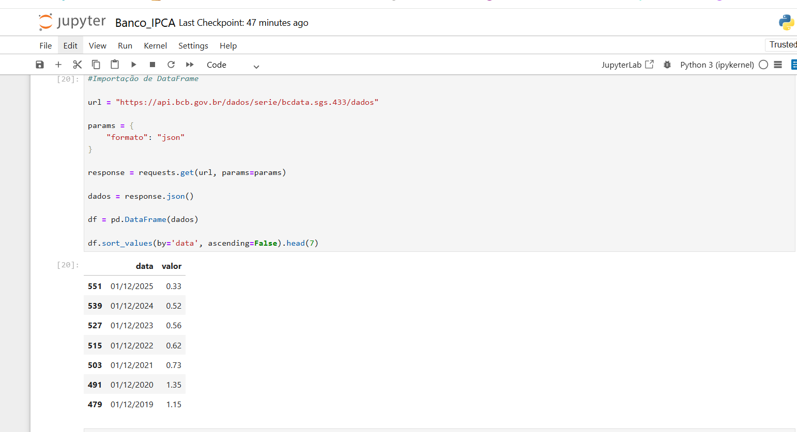
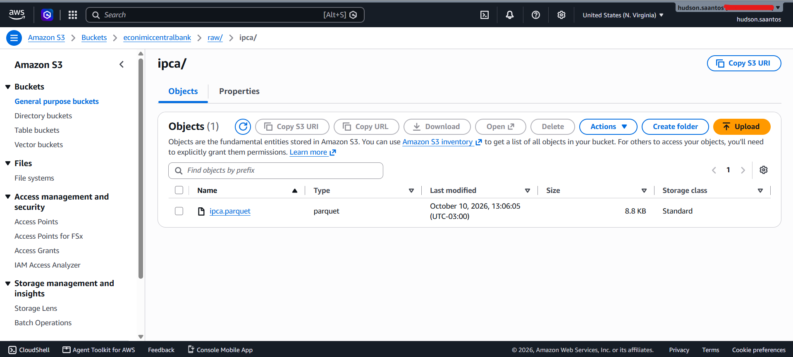
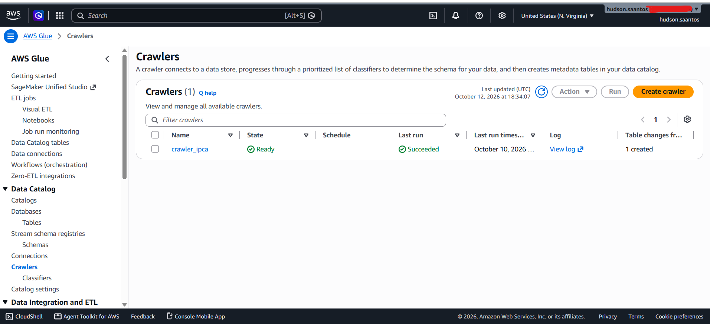
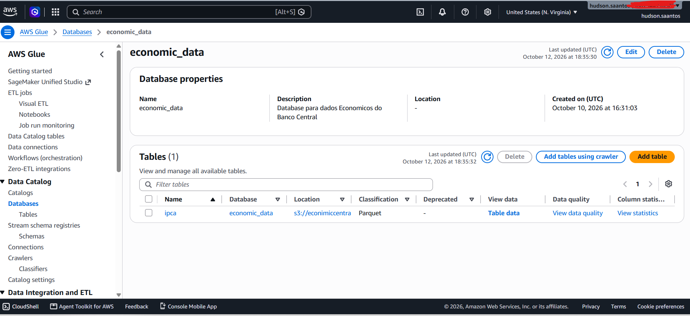
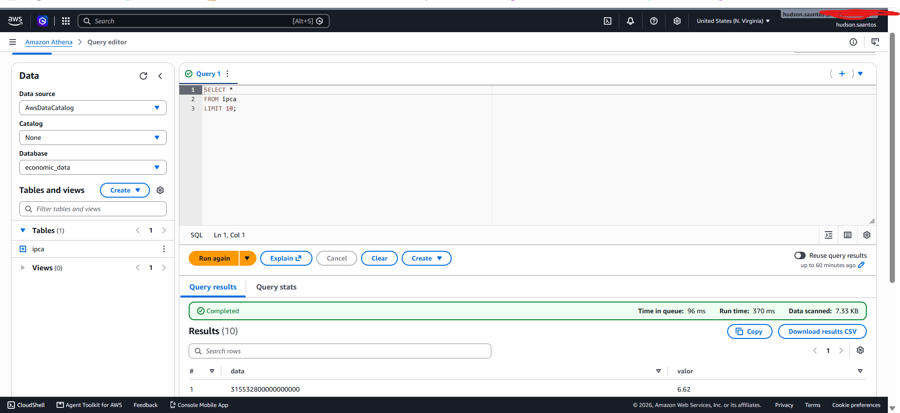

# 🏦 AWS Economic Data Platform

Pipeline de Engenharia de Dados na AWS que ingere indicadores econômicos da **API pública do Banco Central do Brasil (SGS)**, armazena em um **Data Lake no Amazon S3** em formato **Parquet**, cataloga com **AWS Glue** e disponibiliza para consulta SQL via **Amazon Athena**.


---

## 📌 Objetivo

Construir, de ponta a ponta, uma base serverless de dados econômicos na AWS, cobrindo as etapas essenciais de um pipeline de dados: **ingestão → armazenamento → catalogação → consulta**.

Indicador utilizado na versão atual: **IPCA** (série SGS **433** do Banco Central).

---

## 🏗️ Arquitetura

```text
┌──────────────────────┐
│  API Banco Central   │   SGS - série 433 (IPCA)
└──────────┬───────────┘
           ▼
┌──────────────────────┐
│  Python + Pandas     │   Requests, tipagem e limpeza
└──────────┬───────────┘
           ▼
┌──────────────────────┐
│  Parquet             │   Formato colunar e compacto
└──────────┬───────────┘
           ▼
┌──────────────────────┐
│  Amazon S3           │   s3://<bucket>/raw/ipca/
└──────────┬───────────┘
           ▼
┌──────────────────────┐
│  AWS Glue Crawler    │   Descobre o schema
└──────────┬───────────┘
           ▼
┌──────────────────────┐
│  Glue Data Catalog   │   Database: economic_data | Tabela: ipca
└──────────┬───────────┘
           ▼
┌──────────────────────┐
│  Amazon Athena       │   Consultas SQL serverless
└──────────────────────┘
```

---

## 🧰 Tecnologias

| Camada | Tecnologia |
|---|---|
| Linguagem | Python |
| Manipulação de dados | Pandas, PyArrow |
| Consumo de API | Requests |
| Integração com a AWS | Boto3 |
| Armazenamento | Amazon S3 |
| Catálogo de dados | AWS Glue Data Catalog + Crawler |
| Consulta | Amazon Athena (SQL) |
| Segurança | AWS IAM (usuário, role de serviço) |
| Formato de dados | Parquet |

---

## 📂 Estrutura do repositório

```text
aws-economic-data-platform/
│
├── notebooks/
│   └── 01_ipca_ingestion.ipynb     # Ingestão: API → Pandas → Parquet → S3
│
├── sql/
│   └── athena_queries.sql          # Consultas usadas no Athena
│
├── docs/
│   └── images/                     # Prints do projeto
│       ├── 01-notebook-execution.png
│       ├── 02-s3-bucket-structure.png
│       ├── 03-glue-crawler-completed.png
│       ├── 04-glue-table-schema.png
│       └── 05-athena-query-result.png
│
├── .gitignore
├── requirements.txt
└── README.md
```

---

## ⚙️ Como o pipeline funciona

### 1. Ingestão (Python)
O notebook consome a API SGS do Banco Central:

```text
https://api.bcb.gov.br/dados/serie/bcdata.sgs.433/dados?formato=json
```

> ℹ️ Séries **diárias** (ex.: SELIC 432) exigem `dataInicial` e aceitam janela máxima de 10 anos. O IPCA é **mensal**, então retorna a série completa sem esse limite.

### 2. Tratamento (Pandas)
- `data`: convertida de `dd/mm/aaaa` para `datetime`
- `valor`: convertido de texto para `float`

### 3. Persistência (Parquet + S3)
O DataFrame é salvo em Parquet e enviado ao S3 com `boto3`:

```text
s3://<bucket>/raw/ipca/ipca.parquet
```

### 4. Catalogação (AWS Glue)
Um **Glue Crawler** (`crawler_ipca`) varre o prefixo `raw/ipca/`, infere o schema e cria a tabela `ipca` no database `economic_data`, usando uma IAM Role de serviço (`AWSGlueServiceRole-ipca`).

### 5. Consulta (Athena)
O Athena consulta a tabela diretamente no S3, sem servidor ou banco para administrar. Os resultados das queries são gravados em:

```text
s3://<bucket>/athena-results/
```

---

## 🚀 Como reproduzir

### Pré-requisitos
- Conta AWS
- Python 3.x
- [AWS CLI](https://aws.amazon.com/cli/) instalado

### Passo a passo

**1. Clone o repositório e instale as dependências**

```bash
git clone https://github.com/HudsonSanto/aws-economic-data-platform.git
cd aws-economic-data-platform
pip install -r requirements.txt
```

**2. Configure as credenciais AWS (fora do código)**

```bash
aws configure
```

Região usada no projeto: `us-east-1`.

**3. Crie os recursos na AWS**

| Recurso | Nome / Configuração |
|---|---|
| Bucket S3 | `<seu-bucket>` com as pastas `raw/ipca/` e `athena-results/` |
| Glue Database | `economic_data` |
| Glue Crawler | `crawler_ipca` apontando para `s3://<seu-bucket>/raw/ipca/` |
| IAM Role | `AWSGlueServiceRole-ipca` |
| Athena | Query result location: `s3://<seu-bucket>/athena-results/` |

**4. Execute o notebook** `notebooks/01_ipca_ingestion.ipynb`
(lembre de ajustar o nome do bucket).

**5. Rode o Crawler** no console do Glue e consulte no Athena:

```sql
SELECT *
FROM economic_data.ipca
LIMIT 10;
```

---

## 📸 Evidências

### Execução do notebook


### Arquivo Parquet no S3


### Glue Crawler executado com sucesso


### Tabela criada no Glue Data Catalog


### Consulta SQL no Athena


---

## 🔐 Segurança

- Nenhuma credencial AWS é versionada neste repositório.
- O acesso é feito via credenciais locais (`aws configure`) e o `boto3` as lê automaticamente.
- O `.gitignore` bloqueia `.env`, `.aws/`, `*.csv` e `*.parquet`.
- O Glue utiliza uma **IAM Role de serviço**, separada do usuário que executa o notebook.

---

## 💰 Custos

O projeto usa volumes mínimos de dados (poucos KB no S3 e consultas do Athena na casa de KB escaneados), com custo praticamente irrelevante. O Athena cobra por volume de dados lido e o Glue Crawler por tempo de execução (DPU-hora).

---

## 🗺️ Roadmap

- [ ] Incluir novos indicadores (SELIC, Dólar, IBC-Br)
- [ ] Particionar os dados no S3 (ex.: por ano)
- [ ] Automatizar a ingestão com **AWS Lambda**
- [ ] Agendar a execução com **Amazon EventBridge**
- [ ] Separar camadas `raw`, `trusted` e `analytics`
- [ ] Modelagem analítica com **dbt**
- [ ] Dashboard em **Power BI** conectado ao Athena
- [ ] CI/CD com **GitHub Actions**

---

## 👤 Autor

**Hudson dos Santos**

---

## 📄 Fonte dos dados

[Banco Central do Brasil - Sistema Gerenciador de Séries Temporais (SGS)](https://www3.bcb.gov.br/sgspub/)
